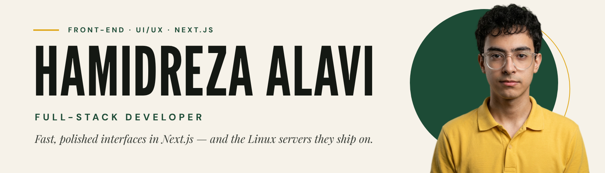
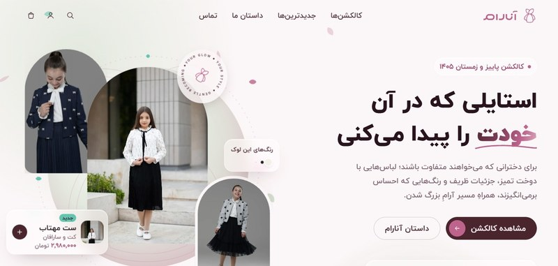
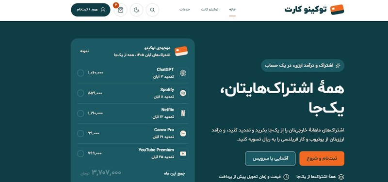
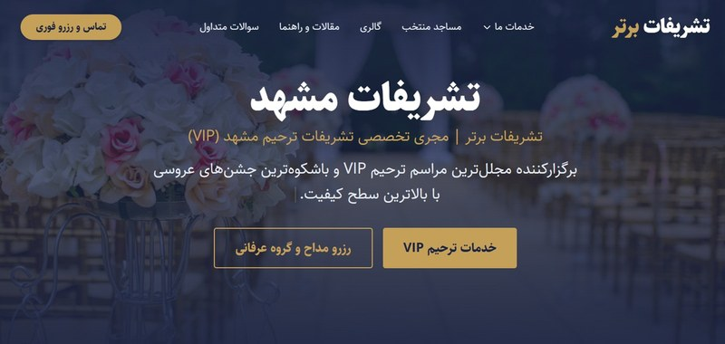
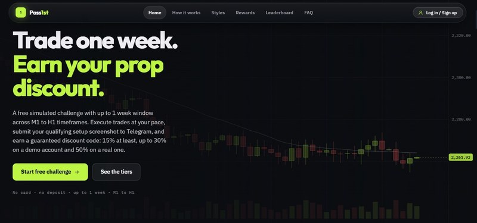

  

  &nbsp;&nbsp;
  &nbsp;&nbsp;
  &nbsp;&nbsp;
  

## About

Full-stack developer who starts at the interface and builds down: **Next.js, React and TypeScript** front ends with **token-driven design systems** and GSAP motion, backed by Node.js, Python and **Linux hosting** I run myself.

- **Front-end & UI/UX** — Next.js, React, TypeScript, Tailwind CSS, GSAP; design systems, Core Web Vitals and technical SEO.
- **Back-end & data** — Node.js, Python (FastAPI), PHP / Laravel, MySQL, n8n automation.
- **DevOps & networks** — Linux and Nginx with HTTPS, caching and backups; Docker and Git; monitoring and packet analysis with Zabbix and Wireshark; Cisco CCNA and VMware vSphere training.
- **Studying** — BSc in Software Engineering, Montazeri Technical College of Mashhad (2026 – present).

## Experience

- **Full-Stack Developer** · Arad Content Creators — part-time, Nov 2026 – present · [iporse.ir](https://iporse.ir/)
- **Lead Developer** · Iranian International Electronic Services Company — part-time, Sep 2026 – present
- **Founder & Full-Stack Developer** · [Tabesh Digital](https://tabeshdigital.ir/) — 2025 – present

## Selected work

<table>
  <tr>
    <td width="50%" align="center">
       
      <b>Anaram</b> — fashion e-commerce storefront
        
      
    </td>
    <td width="50%" align="center">
       
      <b>Tokino Card</b> — subscription services platform
        
      
    </td>
  </tr>
  <tr>
    <td width="50%" align="center">
       
      <b>Tashrifat Bartar</b> — event services site + SEO
        
      
    </td>
    <td width="50%" align="center">
       
      <b>Pass1st</b> — trading-challenge platform
        
      
    </td>
  </tr>
</table>

## Tech stack

**Front-end & UI/UX** 

**Back-end & data** 

**DevOps & networks** 

## Get in touch

  &nbsp;&nbsp;
  &nbsp;&nbsp;
  &nbsp;&nbsp;
  

